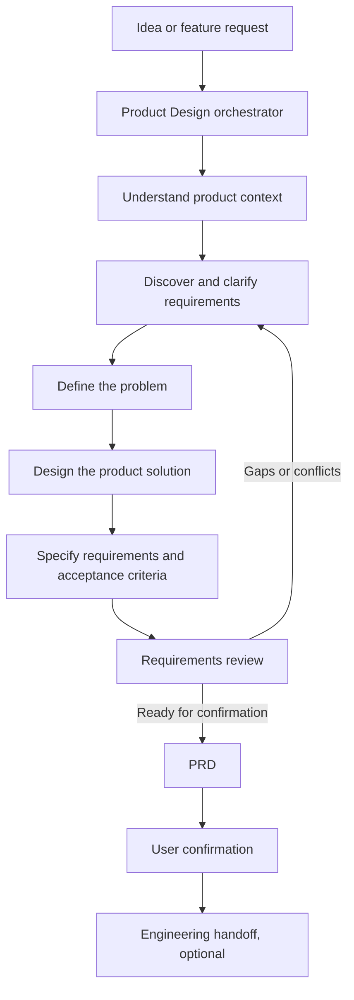
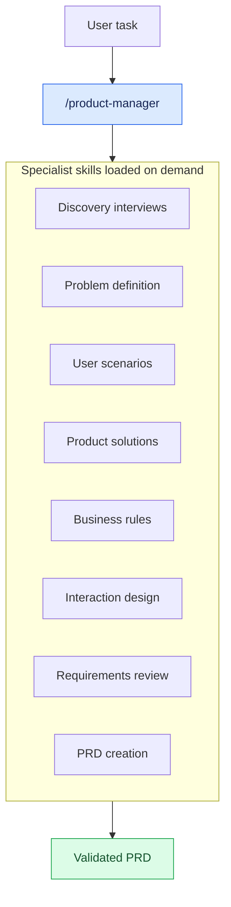
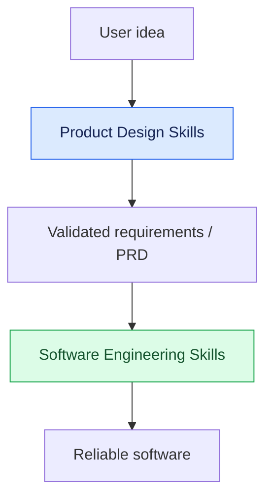

# Product Design Skills

[English](README.md) | [简体中文](README_zh.md)

**License:** [MIT](LICENSE)

**Turn vague ideas into well-defined product requirements with orchestrated AI skills.**

A role-oriented [Agent Skills](https://agentskills.io/) toolkit for software product discovery, requirements analysis, product design, and PRD creation. Designed to help AI coding agents act as thoughtful product managers rather than simply turn feature requests into implementation tasks.

> A feature request is often a proposed solution, not the underlying requirement.

## What ships today (important)

This repository publishes the orchestrator **plus companion specialists** (all MIT, part of this project):

| Shipped folder | Role |
| --- | --- |
| `product-manager/` | Orchestrator |
| `business-rule-design/` | Product-level business rules |
| `product-interaction-design/` | Interaction / UX behavior |
| `product-requirements-review/` | PRD / requirements review |

These companions are **not** vendored third-party packages (local `PROVENANCE.md` + no matching public upstream under these names). True third-party skills (`grilling`, `create-prd`, phuryn/mattpocock/… ) remain **optional** and are installed separately — see `product-manager/references/installed-sources.md`.

After installing only this repo, run `scripts/check-skills` to see what is present vs fallback.

## Compatible agents

Skills in this repo follow the open **Agent Skills** format (`SKILL.md` + optional `references/` / `templates/`). Any host that loads that format can use them. Install the skill folder into the skills root your agent reads:

| Agent | User (global) skills root | Project skills root |
| --- | --- | --- |
| Claude Code | `~/.claude/skills/` | `.claude/skills/` |
| Codex | `~/.agents/skills/` (preferred); `~/.codex/skills/` (legacy) | `.agents/skills/` |
| Cursor | `~/.cursor/skills/` | `.cursor/skills/` |
| OpenClaw | `~/.openclaw/workspace/skills/` | workspace `skills/` |
| GitHub Copilot | `~/.copilot/skills/` | `.github/skills/` |
| Gemini CLI | `~/.gemini/skills/` | `.gemini/skills/` |
| OpenCode | `~/.config/opencode/skills/` | `.opencode/skills/` |
| Windsurf | `~/.codeium/windsurf/skills/` | `.windsurf/skills/` |
| Other Agent Skills hosts | Prefer `~/.agents/skills/` when documented | host-specific |

Use **one checkout**, then copy or symlink into each host you use. Prefer symlinks for local development so edits apply everywhere.

See also: [Agent Skills specification](https://agentskills.io/specification), [client showcase](https://agentskills.io/clients).

## Why Product Design Skills?

AI coding agents can implement ideas quickly, but speed does not guarantee that the right problem is being solved. A request may hide ambiguous goals, missing user scenarios, conflicting business rules, or unclear acceptance criteria.

Product Design Skills puts product thinking before implementation: understand the problem, explore alternatives, discuss meaningful trade-offs, and turn agreed decisions into actionable requirements.

## Core capabilities

| Capability | Purpose |
| --- | --- |
| Product discovery | Identify user goals, pain points, and opportunities. |
| Requirements interview | Clarify important uncertainties through interactive discussion. |
| Problem definition | Separate the underlying problem from a proposed solution. |
| Product solution design | Compare solutions and define scope and priorities. |
| Business rule design | Define rules, states, exceptions, and conflict resolution. |
| Interaction design | Specify user journeys, workflows, and expected behavior. |
| Requirements specification | Produce clear, traceable, testable requirements and acceptance criteria. |
| Requirements review | Find gaps, contradictions, and unnecessary complexity before development. |

## How it works



The orchestrator selects relevant specialist skills according to the task and its complexity. Simple changes remain lightweight; complex features receive deeper discovery, business rule design, and review. The workflow is adaptive, not a mandatory checklist.

## Design principles

- **One entry point:** let the orchestrator select the appropriate specialist skills.
- **Interactive discovery:** ask focused questions, provide recommendations, and challenge assumptions instead of blindly accepting requested solutions.
- **Progressive loading:** read specialist instructions and references only when relevant.
- **Adaptive depth:** match the effort to uncertainty, complexity, and product risk.
- **Quality gates:** resolve important gaps and conflicts before requirements are finalized.
- **Technology and domain agnostic:** applicable to software products regardless of programming language, framework, or business domain.
- **Human-led decisions:** distinguish confirmed requirements from assumptions and proposed decisions.

## Capability orchestration



## Third-party Skills and upstream projects

The following are candidate upstream sources, **not a verified installation manifest**. Check paths, current stars, maintenance, licensing, dependencies and safety before selecting. Prefer mature, relevant skills; avoid installing entire collections or duplicates.

| Upstream repository | Candidate capability / skill | Purpose | Status |
| --- | --- | --- | --- |
| [mattpocock/skills](https://github.com/mattpocock/skills) | grill-me / grill-with-docs | Interactive discovery and contextual interviews | Candidate |
| [phuryn/pm-skills](https://github.com/phuryn/pm-skills) | create-prd / job-stories / user-stories / test-scenarios | PRDs, user scenarios and acceptance criteria | Candidate |
| [bmad-code-org/BMAD-METHOD](https://github.com/bmad-code-org/BMAD-METHOD) | PM / PRD workflows | Discovery and PRD review methods | Candidate |
| [product-on-purpose/pm-skills](https://github.com/product-on-purpose/pm-skills) | problem-statement / JTBD / PRD | Problem framing and requirements specification | Candidate |

A release manifest should record each selected skill’s pinned commit, installation path and original license. The orchestrator and missing specialist capabilities are maintained by this project.

## Installation

Pick a **skills root** from the [Compatible agents](#compatible-agents) table, then install **all shipped folders** (orchestrator + companions).

### Recommended (scripts)

```bash
git clone https://github.com/neverwork-lab/product-design-skills.git
cd product-design-skills

# Choose ONE host root, e.g.:
#   export SKILLS_ROOT="$HOME/.claude/skills"   # Claude Code
#   export SKILLS_ROOT="$HOME/.agents/skills"   # Codex / portable
#   export SKILLS_ROOT="$HOME/.cursor/skills"   # Cursor
#   export SKILLS_ROOT="$HOME/.openclaw/workspace/skills"  # OpenClaw

export SKILLS_ROOT="${SKILLS_ROOT:-$HOME/.agents/skills}"
chmod +x scripts/*.sh
./scripts/install-skills.sh          # copy
# ./scripts/install-skills.sh symlink  # or live link to this checkout
./scripts/check-skills.sh            # presence + fallback report
```

```powershell
git clone https://github.com/neverwork-lab/product-design-skills.git
Set-Location product-design-skills
$env:SKILLS_ROOT = "$HOME\.agents\skills"   # or .claude\skills / .cursor\skills / …
.\scripts\install-skills.ps1                # -Mode symlink -Force optional
.\scripts\check-skills.ps1
```

`install-skills` installs: `product-manager`, `business-rule-design`, `product-interaction-design`, `product-requirements-review`. It skips existing directories unless you pass `-Force` / `FORCE=1`.

### Verify in the agent

1. Restart the agent / start a new session.
2. Invoke `/product-manager` (or `/skill product-manager`), or ask in natural language.
3. If discovery fails, ask the agent to read `product-manager/SKILL.md` from the install path.

## Usage

Once installed, invoke the orchestrator, then describe your goal in natural language:

```text
/product-manager
I want to add a quick-launch feature to my desktop application.
Help me understand the actual user needs before designing the feature.
```

Other examples:

- I have an idea for a new SaaS product. Help me define its MVP.
- Users find the current search feature difficult to use. Help me identify the problem and design improvements.
- Review this PRD for missing scenarios, conflicting rules, and unclear acceptance criteria.

The expected outcome is an agreed product specification or PRD, not an unsolicited implementation.

### Repository structure

```text
product-design-skills/
├── README.md / README_zh.md / LICENSE / CONTRIBUTING.md
├── scripts/
│   ├── install-skills.{sh,ps1}
│   └── check-skills.{sh,ps1}
├── product-manager/                 # orchestrator
├── business-rule-design/            # shipped companion
├── product-interaction-design/      # shipped companion
└── product-requirements-review/     # shipped companion
```

## Working with Software Engineering Skills

[Software Engineering Skills](https://github.com/neverwork-lab/software-engineering-skills) is the companion toolkit for architecture, technical design, implementation, and verification.



Both toolkits are intended to work independently or together. Product Design defines **why and what**; Software Engineering determines **how**. Engineering constraints that change product behavior should be discussed rather than silently changing confirmed requirements.

## Roadmap

- [ ] Core orchestrator and capability registry
- [ ] Curated specialist skills and dependency management
- [ ] Lightweight and detailed PRD templates
- [ ] Requirements review and workflow evaluations
- [ ] Install helpers (multi-host copy/symlink) and smoke checks
- [ ] Verify on Claude Code, Codex, Cursor, OpenClaw, and other Agent Skills hosts

## Contributing

Contributions are welcome, especially real-world examples, improvements to discovery workflows, requirement quality checks, and reproducible evaluations. Please keep the toolkit domain-agnostic and avoid unnecessary process overhead.

## Credits and license

This project is released under the [MIT License](LICENSE). Copyright (c) 2026 neverwork-lab.

Third-party skills you install separately keep their original licenses. See [THIRD_PARTY_NOTICES.md](THIRD_PARTY_NOTICES.md) and `product-manager/references/installed-sources.md`.

Contribution guide: [CONTRIBUTING.md](CONTRIBUTING.md).

Part of the **neverwork-lab** open-source series.
