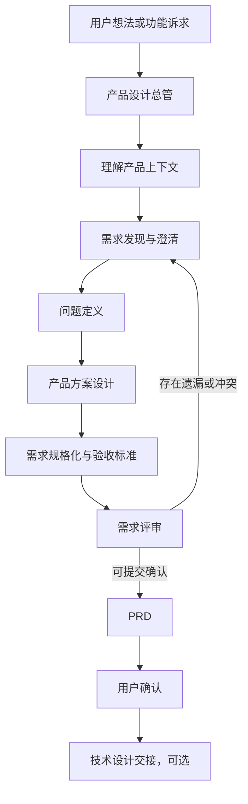
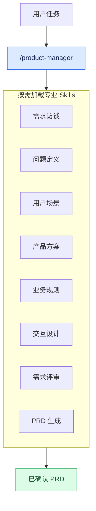
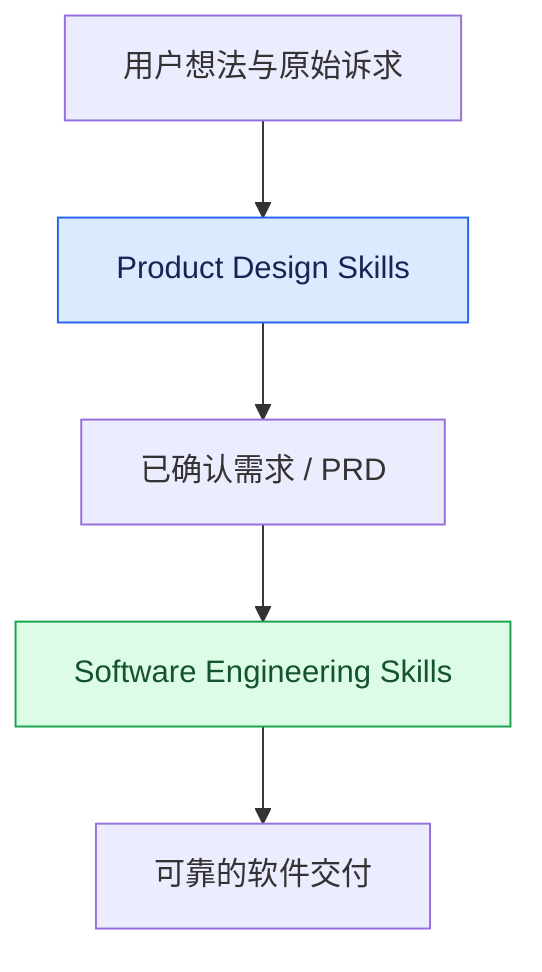

# Product Design Skills · 软件产品设计

[English](README.md) | [简体中文](README_zh.md)

**许可证：** [MIT](LICENSE)

**通过 AI 专业 Skills 编排，将模糊诉求转化为明确的产品需求。**

一套面向软件产品发现、需求分析、产品设计和 PRD 编写的 [Agent Skills](https://agentskills.io/) 体系。旨在让 AI 编程助手像专业产品经理一样思考，而不是简单地将用户提出的功能转换为开发任务。

> 客户提出的功能往往只是候选解决方案，而非背后的真实需求。

## 当前实际交付（重要）

本仓库发布**总管 + 配套专项**（均为本仓库 MIT 内容）：

| 目录 | 角色 |
| --- | --- |
| `product-manager/` | 总管 |
| `business-rule-design/` | 产品级业务规则 |
| `product-interaction-design/` | 交互 / UX 行为 |
| `product-requirements-review/` | PRD / 需求评审 |

这些配套专项**不是**公开第三方包的直接拷贝（见各目录 `PROVENANCE.md`；未找到同名上游）。真正的第三方（`grilling`、`create-prd`、phuryn/mattpocock 等）仍为**可选**，需另行安装——见 `product-manager/references/installed-sources.md`。

安装后请运行 `scripts/check-skills` 查看已安装项与降级提示。

## 兼容的 Agent

本仓库遵循开放的 **Agent Skills** 格式（`SKILL.md` + 可选的 `references/` / `templates/`）。凡支持该格式的宿主均可使用。将 skill 目录安装到对应 Agent 的 skills 根目录：

| Agent | 用户级（全局）目录 | 项目级目录 |
| --- | --- | --- |
| Claude Code | `~/.claude/skills/` | `.claude/skills/` |
| Codex | `~/.agents/skills/`（推荐）；`~/.codex/skills/`（旧） | `.agents/skills/` |
| Cursor | `~/.cursor/skills/` | `.cursor/skills/` |
| OpenClaw | `~/.openclaw/workspace/skills/` | 工作区 `skills/` |
| GitHub Copilot | `~/.copilot/skills/` | `.github/skills/` |
| Gemini CLI | `~/.gemini/skills/` | `.gemini/skills/` |
| OpenCode | `~/.config/opencode/skills/` | `.opencode/skills/` |
| Windsurf | `~/.codeium/windsurf/skills/` | `.windsurf/skills/` |
| 其他 Agent Skills 宿主 | 文档未指定时优先 `~/.agents/skills/` | 以宿主文档为准 |

建议只保留**一份检出**，再按需复制或符号链接到各宿主目录；本地开发优先用 symlink，改一处处处生效。

参考：[Agent Skills 规范](https://agentskills.io/specification)、[客户端一览](https://agentskills.io/clients)。

## 为什么需要 Product Design Skills？

AI 编程助手能够快速实现想法，但开发速度并不代表解决了正确的问题。一个功能诉求背后可能存在模糊的目标、遗漏的用户场景、冲突的业务规则和不明确的验收标准。

Product Design Skills 强调先进行产品思考，再进入开发：理解真实问题，探索候选方案，讨论关键取舍，将双方确认的决策转化为可执行的产品需求。

## 核心能力

| 能力 | 职责 |
| --- | --- |
| 产品发现 | 识别用户目标、痛点和产品机会。 |
| 需求访谈 | 通过交互式讨论澄清重要不确定性。 |
| 问题定义 | 区分真实问题和候选解决方案。 |
| 产品方案设计 | 比较方案，明确功能范围及优先级。 |
| 业务规则设计 | 定义规则、状态、异常和冲突解决机制。 |
| 交互设计 | 明确用户路径、操作流程和预期行为。 |
| 需求规格化 | 形成清晰、可追踪、可测试的需求及验收标准。 |
| 需求评审 | 在开发前发现遗漏、矛盾和不必要的复杂度。 |

## 工作原理



总管根据任务及复杂度选择相关专业 Skills。简单修改保持轻量，复杂功能则深入开展需求发现、业务规则设计和评审。工作流是动态适配的，而非强制执行的固定清单。

## 设计原则

- **统一入口：** 由总管选择合适的专业 Skills。
- **交互式需求发现：** 有针对性地提问，提供专业建议，质疑假设，而非盲目接受用户方案。
- **渐进式加载：** 仅在需要时读取专业指令和参考资料。
- **动态设计深度：** 根据不确定性、复杂度及产品风险调整投入。
- **质量门禁：** 在需求定稿前解决重要遗漏与冲突。
- **技术栈与领域无关：** 不限制编程语言、框架或业务领域。
- **用户主导决策：** 区分已确认需求、待验证假设及建议方案。

## 能力编排图



## 第三方 Skills 与上游项目

以下是拟筛选的上游来源，**不是已安装清单**。安装前需核实 Skill 路径、当前 Star 数、维护状态、许可证、依赖和安全性。优先成熟且匹配任务的项目；不整库安装，不重复安装。

| 上游仓库 | 候选能力 / Skill | 用途 | 状态 |
| --- | --- | --- | --- |
| [mattpocock/skills](https://github.com/mattpocock/skills) | grill-me / grill-with-docs | 需求访谈、追问、领域理解 | 待验证 |
| [phuryn/pm-skills](https://github.com/phuryn/pm-skills) | create-prd / job-stories / user-stories / test-scenarios | PRD、用户场景及验收标准 | 待验证 |
| [bmad-code-org/BMAD-METHOD](https://github.com/bmad-code-org/BMAD-METHOD) | PM / PRD workflows | 产品发现、需求评审方法 | 待验证 |
| [product-on-purpose/pm-skills](https://github.com/product-on-purpose/pm-skills) | problem-statement / JTBD / PRD | 问题定义与需求规格化 | 待验证 |

最终发布时将在依赖清单中记录选定 Skill 的固定 commit、安装路径和原始许可证。总管及缺失的专项能力由本项目维护。

## 安装

先从[兼容的 Agent](#兼容的-agent)表选定 **skills 根目录**，再安装本仓**全部已发布目录**（总管 + 配套专项）。

### 推荐（脚本）

```bash
git clone https://github.com/neverwork-lab/product-design-skills.git
cd product-design-skills
export SKILLS_ROOT="${SKILLS_ROOT:-$HOME/.agents/skills}"
chmod +x scripts/*.sh
./scripts/install-skills.sh
./scripts/check-skills.sh
```

```powershell
git clone https://github.com/neverwork-lab/product-design-skills.git
Set-Location product-design-skills
$env:SKILLS_ROOT = "$HOME\.agents\skills"
.\scripts\install-skills.ps1
.\scripts\check-skills.ps1
```

`install-skills` 会安装：`product-manager`、`business-rule-design`、`product-interaction-design`、`product-requirements-review`。

### 在 Agent 中验证

1. 重启 Agent / 新开会话。
2. 调用 `/product-manager`（或 `/skill product-manager`），或用自然语言。
3. 若未发现，显式要求读取安装路径下的 `product-manager/SKILL.md`。

## 使用方式

安装后调用总管，再用自然语言描述目标：

```text
/product-manager
我想给当前桌面软件增加快捷启动功能。
请先帮我理解真实用户需求，再进行功能设计。
```

其他使用示例：

- 我有一个 SaaS 产品想法，帮我明确 MVP 范围。
- 用户觉得现有搜索功能不好用，帮我定位问题并设计优化方案。
- 检查这份 PRD 是否存在场景遗漏、规则冲突和不明确的验收标准。

预期交付物是经过确认的产品规格或 PRD，而不是未经授权的代码实现。

### 目录结构

```text
product-design-skills/
├── README.md / README_zh.md / LICENSE / CONTRIBUTING.md
├── scripts/install-skills.* 、 check-skills.*
├── product-manager/
├── business-rule-design/
├── product-interaction-design/
└── product-requirements-review/
```

## 与 Software Engineering Skills 协作

[Software Engineering Skills](https://github.com/neverwork-lab/software-engineering-skills) 是配套的软件架构、技术设计、开发与验证能力体系。



两套体系可以独立使用，也可以组合协作。产品设计解决**为什么做、做什么**；软件工程解决**如何设计与实现**。如果技术约束影响产品行为，应重新协商，而不是擅自改变已确认需求。

## 路线图

- [ ] 核心总管及能力注册表
- [ ] 精选专业 Skills 及依赖管理
- [ ] 轻量与详细 PRD 模板
- [ ] 需求评审及工作流评估
- [ ] 多宿主安装助手（复制 / 符号链接）与冒烟检查
- [ ] 在 Claude Code、Codex、Cursor、OpenClaw 及其他 Agent Skills 宿主上验证

## 贡献

欢迎贡献真实使用案例、需求发现工作流优化、需求质量检查方法及可复现的评估用例。请保持领域通用性，避免引入不必要的流程负担。

## 致谢与许可证

本项目采用 [MIT License](LICENSE)。Copyright (c) 2026 neverwork-lab。

你另行安装的第三方 Skills 仍受其原始许可证约束。详见 [THIRD_PARTY_NOTICES.md](THIRD_PARTY_NOTICES.md) 与 `product-manager/references/installed-sources.md`。

贡献指南：[CONTRIBUTING.md](CONTRIBUTING.md)。

本项目属于 **neverwork-lab** 开源系列。
