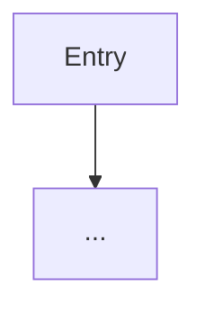

# Interaction Design — {{title}}

## Jobs & paths

| Job | Primary path | Frequency | Pain today |

## Entry points & IA

- Entries:
- Navigation impact:
- Consistency with current product:

## Happy path

## Alternate / exception paths

| Case | User sees / can do | System behavior |

## Feedback & confirmations

| Action | Feedback | Needs confirm? | Undo? |

## States matrix

See also `references/state-matrix.md`.

| Screen/Step | Loading | Empty | Success | Error | Disabled | Retry | Cancel |
|-------------|---------|-------|---------|-------|----------|-------|--------|

## Effort & learnability

- Extra steps introduced:
- Risks of confusion:

## Acceptance-oriented interaction criteria

- [ ]
